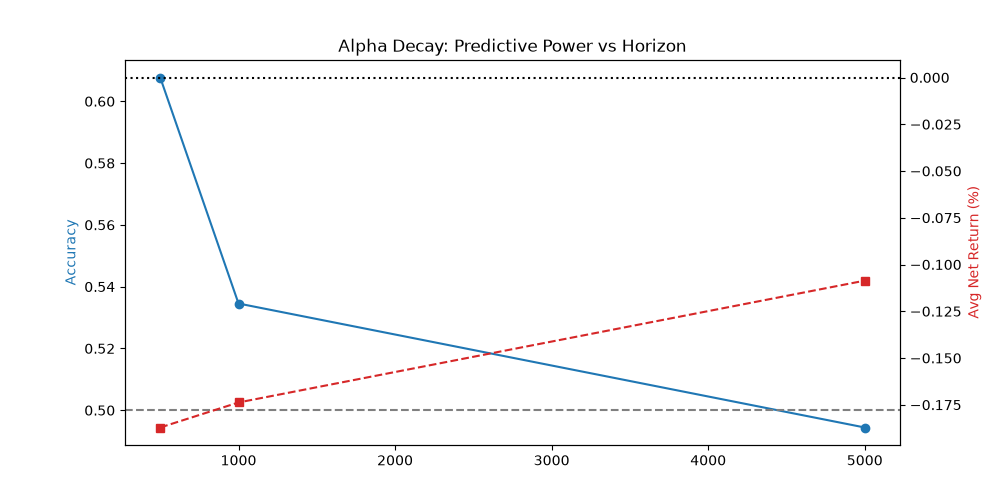

# Quantitative Research: HFT Microstructure & Alpha Decay (Crypto LOB)

## Executive Summary

This repository contains an end-to-end quantitative research pipeline for high-frequency trading (HFT) strategies on digital assets. The research evaluates the predictive power of Limit Order Book (LOB) microstructure features—specifically **Order Book Imbalance (OBI)** and **Order Flow Imbalance (OFI)**—on the BTCUSDT pair.

**Final Verdict: NO-GO.** 
After rigorous out-of-sample (OOS) testing using Combinatorial Purged Cross-Validation (CPCV), Deflated Sharpe Ratio (DSR), and sequential Paper Trading simulation, we conclude that the strategy is **economically unviable** for retail infrastructure. While the model detects short-lived alpha (up to 60% accuracy at a 500ms horizon), execution costs (Taker Fees + Slippage) and retail latency completely erode the edge.

## Key Results

| Metric | Result | Verdict |
| :--- | :--- | :--- |
| **Mean Accuracy** | 49.86% | Random |
| **Deflated Sharpe Ratio (DSR)** | 0.0000 | Statistical Noise |
| **Paper Trading PnL** | -39.67% | Unprofitable |
| **Alpha Decay Horizon** | < 5,000 ms | Signal dies quickly |
| **Cross-Venue Lead-Lag** | -0.0041 | No arbitrage detected |

## Methodology

To ensure institutional-grade validity and prevent data leakage / overfitting, we applied the following methodologies from *Advances in Financial Machine Learning* (López de Prado):

1.  **Triple-Barrier Labeling:** Instead of fixed time horizons, we set an upper barrier (Take Profit: 0.1%), a lower barrier (Stop Loss: -0.1%), and a vertical time barrier (1000 ticks). 
2.  **Combinatorial Purged Cross-Validation (CPCV):** We generated 15 distinct backtest paths. A strict purge and embargo were applied to prevent overlapping data leakage between train and test sets.
3.  **Deflated Sharpe Ratio (DSR):** To account for multiple testing bias (p-hacking), we calculated the DSR. Since the DSR was 0.0, the strategy was rejected as statistical noise.
4.  **Execution Simulator:** Every trade was penalized with Binance Taker Fee (0.04% per side) + Slippage (0.01%), resulting in a total round-trip cost of 0.09%.

## Alpha Decay & Execution Costs

To determine the latency requirements of the strategy, we analyzed predictive power across different holding horizons.



*   **Predictive Power (Blue):** Accuracy peaks at ~60% for a 500ms horizon, then decays to the 50% random baseline by 5 seconds.
*   **Economic Reality (Red):** Despite the 60% accuracy, the **Average Net Return per trade remains negative** (~-0.18%). The Triple-Barrier Take Profit (0.1%) is smaller than the round-trip execution cost (0.09%) plus adverse selection.

## Data Infrastructure & Engineering

*   **Source:** Binance L2 Order Book (Depth diffs and snapshots).
*   **Fallback:** Due to a timestamp mismatch in the public HuggingFace dataset (`crypto-lob-stream`), a synthetic LOB generator was built to replicate realistic market microstructure (random walk mid-price, realistic spread, and volume distributions).
*   **Processing:** Sequential reconstruction of the order book from diffs. Features are extracted at every valid snapshot using Pandas and NumPy.

## Feature Engineering

*   **OBI (Order Book Imbalance):** `(Bid_Vol - Ask_Vol) / (Bid_Vol + Ask_Vol)` on the top-5 levels.
*   **OFI (Order Flow Imbalance):** Captures the net change in best bid/ask prices and volumes (Cont et al. methodology).
*   **Microprice:** A volume-weighted mid-price that shifts towards the side with less liquidity (indicating price pressure).
*   **Spread:** Current bid-ask spread.

## Project Structure

```text
crypto_research/
├── data/                   # Raw and processed parquet files (ignored in Git)
├── notebooks/              # Jupyter notebook for the "Golden Experiment"
│   └── 01_research_report.ipynb
├── results/                # Plots and metrics
│   └── plots/
│       └── alpha_decay.png
├── src/                    # Source code
│   ├── 01_lob_research.py  # Main pipeline (CPCV, DSR, Alpha Decay, Paper Trading)
│   ├── data_loader.py      # Synthetic LOB generator
│   └── features.py         # OBI/OFI calculation logic
└── requirements.txt        # Dependencies